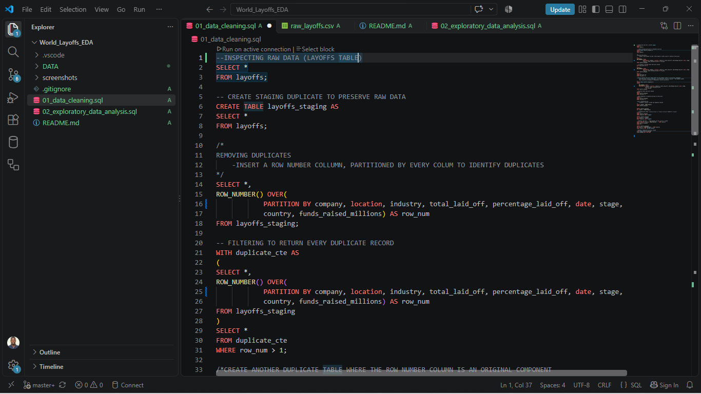
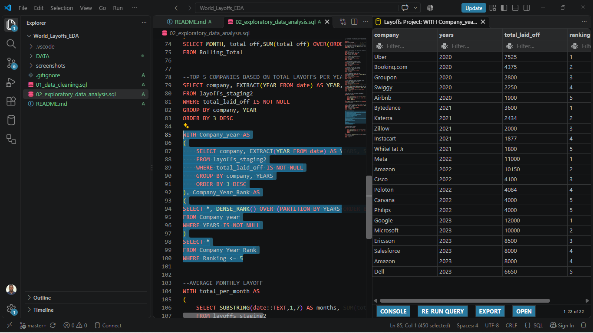
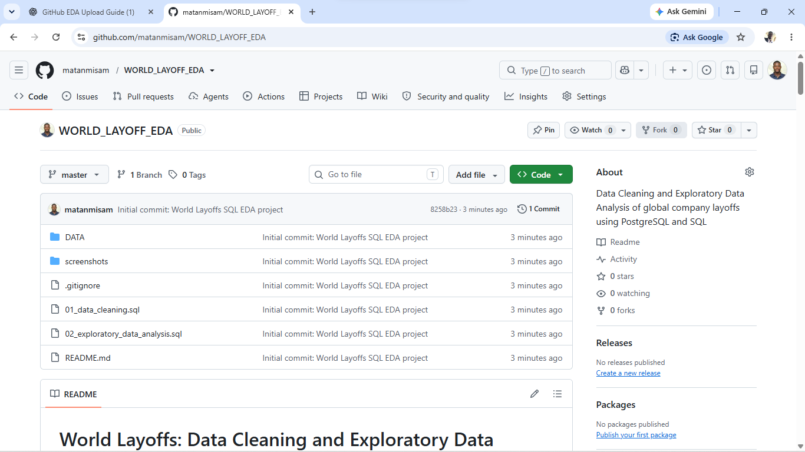

# World Layoffs: Data Cleaning and Exploratory Data Analysis with SQL

## Project Overview

This project uses SQL to clean and explore a dataset of company layoffs around the world. The objective is to prepare the data for analysis and investigate patterns in layoffs across companies, industries, countries, company stages, and time periods.

Using PostgreSQL, I worked through a data-cleaning workflow and performed exploratory data analysis (EDA) using aggregation, common table expressions (CTEs), date functions, and window functions.

The project demonstrates practical SQL skills in data preparation, data quality checks, aggregation, ranking, and trend analysis.

## Objectives

- Preserve the original dataset while preparing a separate working copy.
- Identify and remove duplicate records.
- Standardize inconsistent text values.
- Convert date values to an appropriate date data type.
- Analyze layoffs by company, industry, country, company stage, year, and month.
- Calculate cumulative monthly layoffs.
- Rank companies by layoffs within each year.
- Explore the distribution and scale of reported layoffs.

## Tools and Technologies

- **Database:** PostgreSQL
- **SQL development environment:** Visual Studio Code
- **Database management:** pgAdmin 4
- **Version control:** Git and GitHub
- **Data format:** CSV

## Dataset

The dataset contains information about company layoffs, including fields such as:

| Column                  | Description                                           |
| ----------------------- | ----------------------------------------------------- |
| `company`               | Name of the company reporting layoffs                 |
| `location`              | Location associated with the company or layoff record |
| `industry`              | Industry classification                               |
| `total_laid_off`        | Reported number of employees laid off                 |
| `percentage_laid_off`   | Reported proportion of the workforce laid off         |
| `date`                  | Date associated with the layoff event                 |
| `stage`                 | Company funding or development stage                  |
| `country`               | Country associated with the record                    |
| `funds_raised_millions` | Reported funding raised, in millions                  |

**Data source:** AlexTheAnalyst — MySQL YouTube Series (GitHub)
[https://www.youtube.com/redirect?event=video_description&redir_token=QUZZTVljSFp4c3hzT3RkWl9UcFZ2NExiSXc2Q3xBSTVJdTV1U2xGblBsMzJ6RURVZWJPLXMzbEpOQUQ2VDR4N0ZjbTQxZXJCZk9YbzlxdzIwTkdVOUVEbEFlS2ZJRnVwTHFrLUhCbUlQNlJNa2dQdjN1SmJRNFZCWDRYRDhTeHNG&q=https%3A%2F%2Fgithub.com%2FAlexTheAnalyst%2FMySQL-YouTube-Series&v=4UltKCnnnTA]

I've verified dataset's date range as March 11, 2020, to March 6, 2023.

## Project Structure

```text
WORLD_LAYOFFS_EDA/
├── data/
│   ├── raw_layoffs.csv
│   └── cleaned_layoffs.csv
├── 01_data_cleaning.sql
├── 02_exploratory_data_analysis.sql
├── README.md
└── .gitignore
```

The `data` folder contains the original and cleaned CSV files. The SQL scripts separate data preparation from exploratory analysis.

## Methodology

### 1. Data Inspection and Staging

I inspected the original `layoffs` table and created staging tables to work with copies of the data while preserving the original table.

- `layoffs`: Original imported dataset.
- `layoffs_staging`: Initial staging copy.
- `layoffs_staging2`: Working table containing a row number used to identify duplicate records.

This approach separates the original data from the cleaning process.

### 2. Duplicate Identification and Removal

I used the `ROW_NUMBER()` window function with `PARTITION BY` across the dataset's columns to identify records with matching values.

A common table expression (CTE) was used to filter records assigned a row number greater than one. These records were then removed from the working table.

### 3. Data Standardization

I applied text-cleaning and standardization operations to improve consistency:

- Used `TRIM()` to remove unwanted surrounding spaces from company names.
- Standardized industry values beginning with `Crypto` to a consistent `Crypto` label.
- Removed trailing periods from country values where applicable.

### 4. Date Formatting

I converted the `date` column to PostgreSQL's `DATE` data type to support date-based grouping and analysis.

### 5. Exploratory Data Analysis

After preparing the data, I used SQL queries to investigate the distribution and patterns of layoffs.

## Exploratory Data Analysis

The analysis covers the following areas.

### Overall Layoff Statistics

- Maximum reported number of employees laid off in a record.
- Maximum reported layoff percentage.
- Records where the reported layoff percentage is 100%, including examination of total layoffs.

### Layoffs by Company

- Total reported layoffs aggregated by company.
- Companies with the highest cumulative layoffs.
- Top-ranked companies by total layoffs for each year.

### Layoffs by Industry

- Total layoffs grouped by industry to identify industries with the largest reported layoff counts.

### Layoffs by Country

- Total layoffs grouped by country to compare reported layoff counts geographically.

### Layoffs by Company Stage

- Total layoffs grouped by company stage to examine differences across company funding or development stages.

### Yearly Layoff Trends

- Total layoffs grouped by year using date extraction functions.

### Monthly Layoff Trends

- Total layoffs grouped by month.
- A running cumulative total of layoffs over the observed months, calculated using a window function.

### Ranking Companies by Year

I used common table expressions and the `DENSE_RANK()` window function to rank companies by total layoffs within each year. The final query filters for ranks of five or lower, allowing ties at the cutoff to appear.

### Monthly Layoff Totals

The analysis script also includes a query intended to examine average monthly layoffs. Its aggregation logic should be validated to ensure that the final result represents an average across months rather than each month's individual total.

## Project Screenshots

### Data Cleaning



### Exploratory Data Analysis



### GitHub Repository



View the live project: [WORLD_LAYOFF_EDA](https://github.com/matanmisam/WORLD_LAYOFF_EDA)

## SQL Concepts Demonstrated

- `SELECT` and `WHERE`
- `UPDATE` and `DELETE`
- `CREATE TABLE AS SELECT`
- `ALTER TABLE` and data type conversion
- `TRIM()` and `LIKE`
- `GROUP BY` and aggregate functions such as `SUM()`, `MAX()`, and `AVG()`
- Common table expressions (CTEs)
- `ROW_NUMBER()` for duplicate identification
- `DENSE_RANK()` for ranking companies
- `SUM() OVER()` for running totals
- `EXTRACT()` and date-based grouping
- Sorting and filtering aggregated results

## Key Findings

The SQL queries are designed to identify:

- Which companies account for the largest reported layoff totals.
- Which industries and countries have the highest aggregated layoff counts.
- How reported layoffs vary across company stages.
- How layoffs change across years and months.
- Which companies rank among the highest for layoffs in individual years.
- How cumulative reported layoffs develop over the observed monthly period.

**Note:** Numerical findings and rankings will be added after the queries have been executed and their results verified. No numerical conclusions are claimed in this README without confirmed query output.

## Limitations

- The analysis depends on the completeness, accuracy, and consistency of the supplied dataset.
- Some records may contain missing values, which can affect aggregate calculations and comparisons.
- The analysis describes the reported data and does not establish the causes of layoffs.
- Company totals may reflect multiple layoff events across different dates.
- A reported layoff percentage of 100% and the absolute number of layoffs measure different aspects of an event; missing absolute counts can limit comparisons.
- The results cover only the dates and records represented in the dataset and should not be treated as a complete account of all global layoffs.
- Duplicate identification depends on the selected columns. Records that match across those columns are treated as duplicates by the cleaning logic.
- Results should be interpreted with awareness of the cleaning rules and any remaining data-quality issues.

## How to Reproduce This Project

### Prerequisites

- PostgreSQL installed and running.
- pgAdmin 4 or another PostgreSQL client.
- Visual Studio Code or another SQL editor.
- The original CSV dataset.

### Steps

1. Download the dataset from the source linked in the Dataset section.
2. Import the raw CSV into PostgreSQL as a table named `layoffs`.
3. Open `01_data_cleaning.sql` in your SQL editor and execute the cleaning workflow in order.
4. Verify the resulting cleaned table and review any data-quality issues.
5. Open `02_exploratory_data_analysis.sql` and execute the analysis queries against the cleaned table, `layoffs_staging2`.
6. Review the query results to evaluate layoff patterns by company, industry, country, stage, year, and month.
7. Compare the exported `cleaned_layoffs.csv` with the original dataset when documenting the cleaning process.

The SQL scripts assume that the raw table has been imported and that the required table names and columns exist. Database names, connection settings, and file paths may need to be adjusted for another environment.

## Conclusion

This project demonstrates an end-to-end SQL workflow for preparing a real-world dataset and exploring its contents. It combines data cleaning, standardization, date conversion, aggregation, ranking, and cumulative calculations to examine reported company layoffs across multiple dimensions.

The project also provides a foundation for future analysis and visualization using tools such as Power BI, Tableau, or Python.

## Author
Samuel Oluyinka Matanmi

Aspiring Data Analyst | SQL | PostgreSQL

**SQL Data Analysis Portfolio Project**

This project was developed as part of my practical learning and portfolio development in SQL and data analytics.
